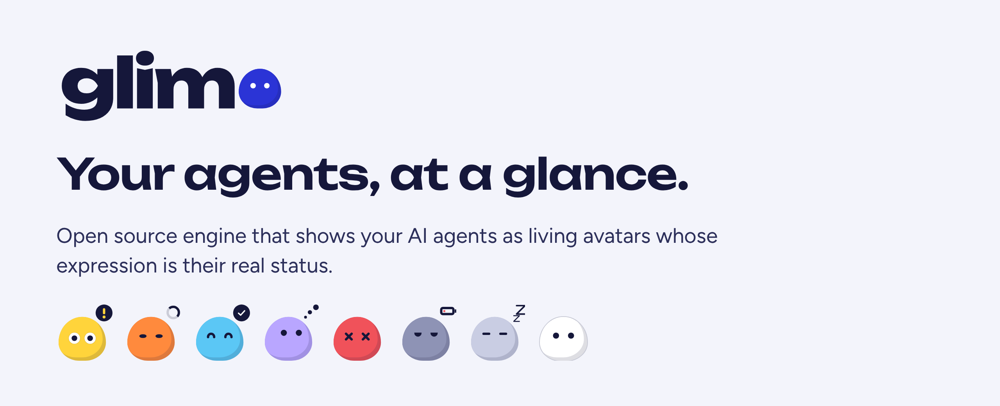
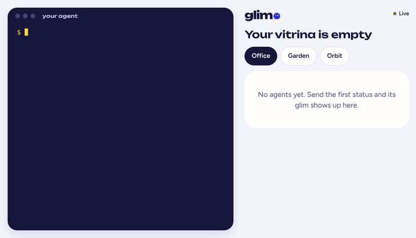

<p align="center">
  <picture>
    <source media="(prefers-color-scheme: dark)" srcset="docs/assets/banner-dark.png">
    
  </picture>
</p>

# Glimo: todos tus agentes, de un vistazo

<p align="center">
  <a href="https://github.com/lukchamo/glimo/actions/workflows/ci.yml"></a>
  <a href="https://www.npmjs.com/package/glimo"></a>
  <a href="LICENSE"></a>
  <a href="docs/spec.md"></a>
</p>

Glimo muestra a tus agentes de IA como avatares vivos (glims) cuyo gesto es su estado real.
Ves quién trabaja, quién te espera y quién se atascó, y apruebas o respondes desde el mismo
sitio. Funciona con cualquier agente que hable MCP.

[Web](https://glimo.dev/es/) · [Playground](https://glimo.dev/es/playground) · [Documentación](docs/README.md) · [Spec](docs/spec.md) · [English](README.md)

## Instalar

```bash
npx glimo@latest init
```

¿Sin instalar nada? Crea una vitrina con una sola petición, o en el [playground](https://glimo.dev/es/playground#live):

```bash
curl -X POST https://glimo.dev/api/vitrinas
```

## Demo

<p align="center"></p>

## Cómo funciona

- **Tu agente dice cómo está.** Un JSON pequeño, la [Glimo Spec](docs/spec.md): `working`, `waiting`, `blocked`, `done` y cuatro estados más, traducidos desde Agent Status Protocol.
- **Su glim lo muestra.** Cada estado tiene sus ojos, su color y su señal, así que lees a un equipo entero en un segundo, en el móvil o en una pantalla de pared.
- **Actúas desde la vitrina.** Cada estado trae su acción principal a un toque. Todo lo que envía, paga, publica o borra siempre te pregunta antes.
- **El agente recoge tu decisión** y sigue con lo suyo. Cada decisión queda registrada.
- **Privado por diseño.** Lo que tu agente ve y piensa nunca llega al servidor en claro.

```bash
# Mostrar un agente
npx glimo status ventas waiting "Quiere enviar 12 correos" --action approve:"Aprobar envío":sensitive

# Esperar tu decisión
npx glimo wait ventas
```

## Funciona con

Glimo es un servidor MCP por HTTP, así que cualquier cliente MCP puede usarlo. Tres herramientas: `glimo_status`, `glimo_action`, `glimo_vitrina`.

| Agente         | Cómo                                                                                                        | Estado       |
| -------------- | ----------------------------------------------------------------------------------------------------------- | ------------ |
| Claude Code    | `claude mcp add --transport http glimo https://glimo.dev/mcp/<id> --header "Authorization: Bearer <llave>"` | MCP estándar |
| Codex          | `mcp_servers.glimo` en `~/.codex/config.toml`, o `npx glimo mcp` (stdio)                                    | MCP estándar |
| Cursor         | `mcp.json` con `url` y `headers`                                                                            | MCP estándar |
| Gemini CLI     | `mcpServers` en `settings.json` con `httpUrl` y `headers`                                                   | MCP estándar |
| OpenCode       | `mcp` en `opencode.json`, tipo `remote`                                                                     | MCP estándar |
| Cualquier otro | `curl`, o `npx glimo mcp` para clientes que solo hablan stdio                                               | REST y stdio |

El endpoint está cubierto por pruebas de protocolo en este repositorio. Cuéntanos con qué lo usas: un issue con tu cliente y su versión nos ayuda a marcarlo como verificado.

## Skills

Siete skills de inicio en el formato abierto [Agent Skills](skills/README.md). Funcionan en cualquier agente compatible.

```bash
npx skills add lukchamo/glimo                        # todas
npx skills add lukchamo/glimo --skill glimo-status   # enseña a cualquier agente a informar su estado
```

Publica la tuya en tres pasos: escribe un `SKILL.md`, guárdalo en tu propio repositorio y abre un issue "Skill" para que la listemos.

## Usa el glim en tu app

```tsx
import { Glim } from '@glimo/glim';
import '@glimo/glim/glim.css';

<Glim state="waiting" size={64} locale="es" />;
```

Parpadea, respira, sigue al puntero y reacciona al toque, animando solo propiedades compuestas. Mira [cómo se mantiene a 60 fps](docs/animation-performance.md).

## Alójalo tú

Un Worker de Cloudflare, una base de datos D1 y Durable Objects. [Cinco comandos](docs/self-hosting.md).

```bash
pnpm install && pnpm test     # 110 pruebas en unos 7 segundos
pnpm dev                      # todo en http://localhost:8787
```

## Comunidad

[Issues](https://github.com/lukchamo/glimo/issues) · [Discussions](https://github.com/lukchamo/glimo/discussions) · [Contribuir](CONTRIBUTING.md) · [Seguridad](SECURITY.md) · [Gobernanza](GOVERNANCE.md)

Los documentos de producto originales (PRD, guía de marca, investigación de mercado, privacidad y cifrado) están en [`docs/es/`](docs/es/).

## Licencia

Apache-2.0 © CooWeb. Glimo es un proyecto abierto de CooWeb.
