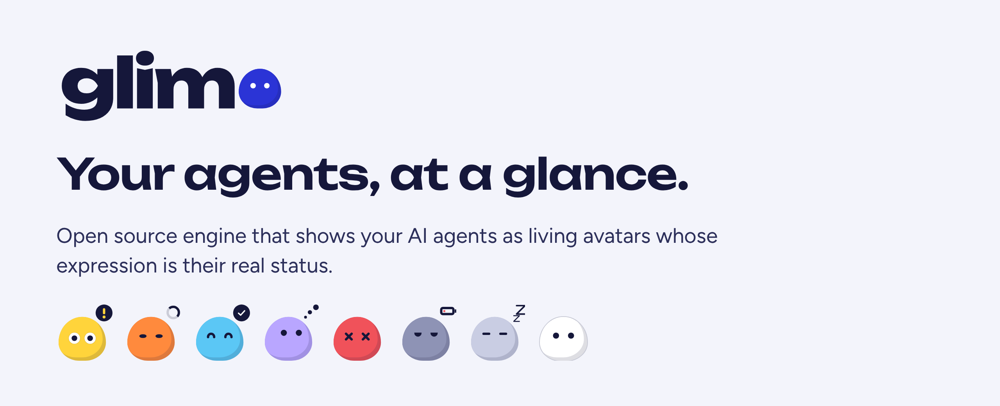
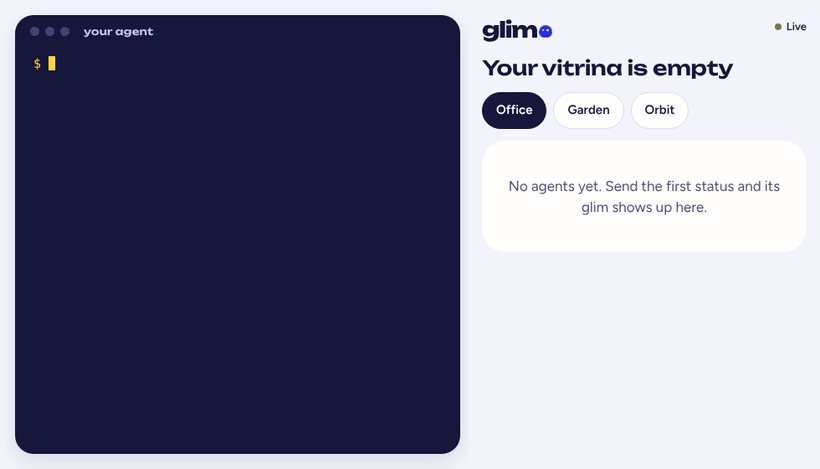

<p align="center">
  <picture>
    <source media="(prefers-color-scheme: dark)" srcset="docs/assets/banner-dark.png">
    
  </picture>
</p>

# Glimo: all your agents, at a glance

<p align="center">
  <a href="https://github.com/lukchamo/glimo/actions/workflows/ci.yml"></a>
  <a href="https://www.npmjs.com/package/glimo"></a>
  <a href="LICENSE"></a>
  <a href="docs/spec.md"></a>
</p>

Glimo shows your AI agents as living avatars (glims) whose expression is their real status.
You see who is working, who is waiting for you and who got stuck, and you approve or answer
from the same place. It works with any agent that speaks MCP.

[Website](https://glimo.dev) · [Playground](https://glimo.dev/playground) · [Docs](docs/README.md) · [Spec](docs/spec.md) · [Español](README.es.md)

## Install

```bash
npx glimo@latest init
```

Nothing to install? Create a vitrina with one request, or in the [playground](https://glimo.dev/playground#live):

```bash
curl -X POST https://glimo.dev/api/vitrinas
```

## Demo

<p align="center"></p>

## How it works

- **Your agent says how it is.** One small JSON, the [Glimo Spec](docs/spec.md): `working`, `waiting`, `blocked`, `done` and four more states, mapped from Agent Status Protocol.
- **Its glim shows it.** Each state has its own eyes, colour and signal, so you read a whole team in one second, on a phone or on a wall.
- **You act from the vitrina.** Every state brings its main action one tap away. Anything that sends, pays, publishes or deletes always asks you first.
- **The agent collects your decision** and gets on with it. Every decision is logged.
- **Private by design.** What your agent sees and thinks never reaches the server in clear text.

```bash
# Show an agent
npx glimo status sales waiting "Wants to send 12 emails" --action approve:"Approve sending":sensitive

# Wait for your decision
npx glimo wait sales
```

## Works with

Glimo is an MCP server over HTTP, so any MCP client can use it. Three tools: `glimo_status`, `glimo_action`, `glimo_vitrina`.

| Agent         | How                                                                                                       | Status         |
| ------------- | --------------------------------------------------------------------------------------------------------- | -------------- |
| Claude Code   | `claude mcp add --transport http glimo https://glimo.dev/mcp/<id> --header "Authorization: Bearer <key>"` | Standard MCP   |
| Codex         | `mcp_servers.glimo` in `~/.codex/config.toml`, or `npx glimo mcp` (stdio)                                 | Standard MCP   |
| Cursor        | `mcp.json` with `url` and `headers`                                                                       | Standard MCP   |
| Gemini CLI    | `mcpServers` in `settings.json` with `httpUrl` and `headers`                                              | Standard MCP   |
| OpenCode      | `mcp` in `opencode.json`, type `remote`                                                                   | Standard MCP   |
| Anything else | `curl`, or `npx glimo mcp` for stdio-only clients                                                         | REST and stdio |

The endpoint is covered by protocol tests in this repo. Tell us what you run it with: an issue with your client and version helps us mark it as verified.

## Skills

Seven starter skills in the open [Agent Skills](skills/README.md) format. They work in any compatible agent.

```bash
npx skills add lukchamo/glimo                        # all of them
npx skills add lukchamo/glimo --skill glimo-status   # teach any agent to report its status
```

Publish yours in three steps: write a `SKILL.md`, keep it in your own repo, open a "Skill" issue to get listed.

## Use the glim in your app

```tsx
import { Glim } from '@glimo/glim';
import '@glimo/glim/glim.css';

<Glim state="waiting" size={64} />;
```

It blinks, breathes, follows the pointer and reacts to touch, animating only composited properties. See [how it stays at 60 fps](docs/animation-performance.md).

## Self-host

One Cloudflare Worker, a D1 database and Durable Objects. [Five commands](docs/self-hosting.md).

```bash
pnpm install && pnpm test     # 110 tests in about 7 seconds
pnpm dev                      # everything on http://localhost:8787
```

## Community

[Issues](https://github.com/lukchamo/glimo/issues) · [Discussions](https://github.com/lukchamo/glimo/discussions) · [Contributing](CONTRIBUTING.md) · [Security](SECURITY.md) · [Governance](GOVERNANCE.md)

## License

Apache-2.0 © CooWeb. Glimo is an open project by CooWeb.
